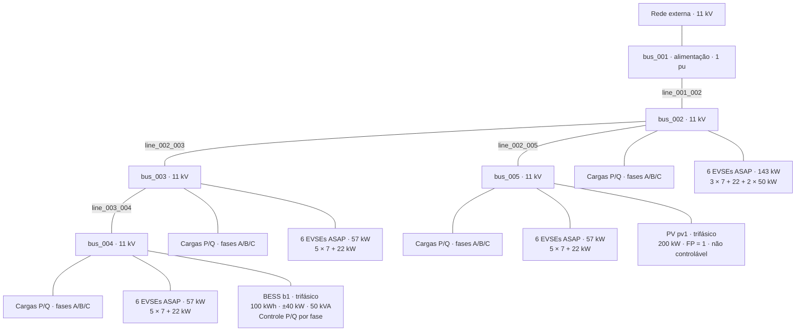
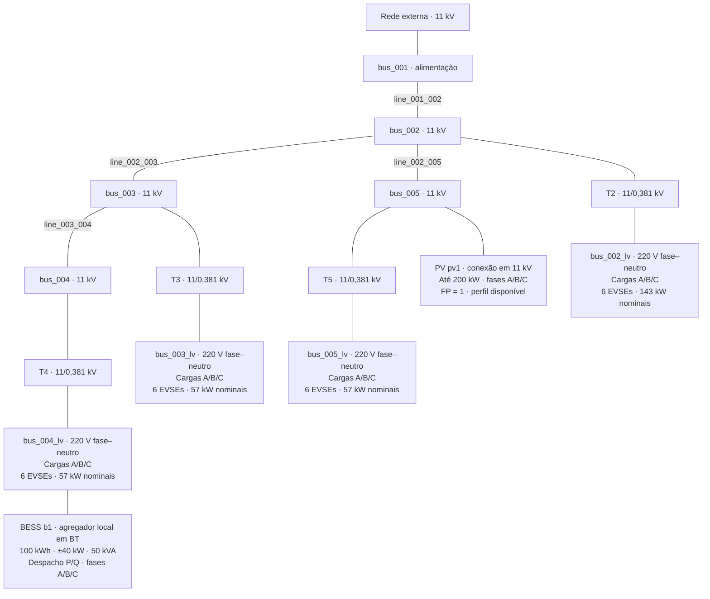

# Diagrama da rede de cinco barramentos

Configuração atual: [Master.dss](../data/switzerland/5bus/dss/Master.dss),
[devices.json](../data/switzerland/5bus/devices.json) e
[config.json](../data/switzerland/5bus/config.json).
As cargas P/Q por fase vêm de
[unbalanced_demand.csv](../data/switzerland/5bus/unbalanced_demand.csv).

## Equivalente anterior em média tensão

A rede é trifásica, com base de 11 kV entre fases e 1 MVA. O `bus_001` é a
alimentação a 1 pu. O diagrama abaixo registra o equivalente anterior, usado nas
baselines sem transformadores, com todos os elementos no nível de 11 kV.
As ligações indicam conectividade, não um sentido obrigatório de potência.

Os 24 EVSEs totalizam **314 kW nominais**, não uma demanda constante.
As sessões determinam conexão e energia requerida. O BESS começa com SoC de
50%, tem limites físicos de 10–100%, eficiência de 95% em cada sentido e
despacho positivo para carga e negativo para descarga.
O PV segue o perfil temporal disponível em `pv.csv`; 200 kW é seu limite,
não uma geração constante.

### EVSEs por barramento e fase na rede atual

Cada ID listado nas colunas monofásicas corresponde a um EVSE de 7 kW.

| Barramento | Fase A · 7 kW cada | Fase B · 7 kW cada | Fase C · 7 kW cada | Trifásicos A/B/C |
|---|---|---|---|---|
| `bus_002_lv` | `e137` | `e142` | `e144` | `e054`: 22 kW; `e001`, `e002`: 50 kW cada |
| `bus_003_lv` | `e160`, `e183` | `e167`, `e185` | `e172` | `e059`: 22 kW |
| `bus_004_lv` | `e209`, `e218` | `e215` | `e197`, `e216` | `e062`: 22 kW |
| `bus_005_lv` | `e235` | `e222`, `e236` | `e227`, `e238` | `e065`: 22 kW |

### Ramos do alimentador

Os valores são os parâmetros totais das linhas, com `Length=1` e `units=none`.
No DSS atual, `R0=R1`, `X0=X1` e a capacitância é zero.

| Linha | Terminais | R1 [Ω] | X1 [Ω] | Corrente nominal [A] |
|---|---|---:|---:|---:|
| `line_001_002` | `bus_001`–`bus_002` | 6,0 | 12,0 | 78,73 |
| `line_002_003` | `bus_002`–`bus_003` | 12,0 | 18,0 | 52,49 |
| `line_003_004` | `bus_003`–`bus_004` | 14,4 | 19,2 | 31,49 |
| `line_002_005` | `bus_002`–`bus_005` | 12,0 | 15,6 | 41,99 |

Os limites configurados de troca com a rede externa são 2 MW para importação
e 2 MW para exportação; o limite reativo é 2 Mvar. Eles são limites de operação,
não a potência nominal de um transformador existente.

## Rede atual com transformadores MT/BT

Esta versão preserva o alimentador de 11 kV e acrescenta um transformador
trifásico 11/0,381051 kV para cada grupo consumidor, nos nós `bus_002` a `bus_005`.
As cargas e os EVSEs passam aos respectivos barramentos de BT, com secundário
em estrela: aproximadamente 381 V entre fases e 220 V entre fase e neutro.
O modelo tem cinco barramentos de MT e quatro de BT. Os nomes das colunas no
CSV de demanda são preservados: `network.load_bus_map` no `config.json` direciona
as cargas de cada nó original ao seu correspondente `_lv`.

O BESS fica no `bus_004_lv`, compartilhando o transformador T4 com as cargas
e EVSEs do agregador local. O PV permanece no `bus_005` de 11 kV, fora desse
agregador, como equivalente no ponto de conexão à MT. A interface de conversão
e eventual transformador próprio da usina solar ficam agregados ao equivalente.

Os valores em kW junto aos EVSEs indicam apenas sua potência instalada; a demanda
convencional é adicional. O BESS observa a tensão local na BT; a geração solar
está em outro nó e não integra sua conta local. Não há cabos de BT nem impedância explícita do neutro;
o neutro do secundário está conectado ao nó de referência 0.

### Parâmetros dos transformadores

| Elemento | Primário | Secundário | Potência nominal |
|---|---|---|---:|
| `Transformer.t2` | `bus_002` | `bus_002_lv` | 400 kVA |
| `Transformer.t3` | `bus_003` | `bus_003_lv` | 250 kVA |
| `Transformer.t4` | `bus_004` | `bus_004_lv` | 250 kVA |
| `Transformer.t5` | `bus_005` | `bus_005_lv` | 250 kVA |

São parâmetros sintéticos de cenário: ligação delta/estrela aterrada, grupo
Dy11 (`LeadLag=Euro`), taps fixos em 1, resistência de 0,5% por enrolamento,
reatância de dispersão `XHL=4%`, perdas a vazio de 0,1% e corrente de
magnetização de 0,5%. O limite normal é igual à potência nominal. As definições
dos parâmetros seguem a [documentação do OpenDSS](https://opendss.epri.com/Properties16.html).

O dimensionamento considera, por fase, o máximo de `sqrt(P_load² + Q_load²)`
dos perfis 2023–2024 mais a potência aparente nominal dos EVSEs daquela fase.
Multiplica-se a maior fase por três e aplica-se margem de 20%, escolhendo a
potência seguinte em `[100, 160, 250, 400, 630, 1000]` kVA. É um critério
conservador, não um projeto térmico ou dado de fabricante.

O BESS é despachável dentro dos limites de potência, capacidade do inversor e
SoC. Para o PV, despacho ativo significa escolher `0 <= P <= P_disponível(t)`;
ele não pode fornecer potência acima do recurso solar. O controle de Q também
deve respeitar a capacidade do inversor. No cenário ativo, o PV ainda opera
com FP unitário e sem curtailment; tornar P/Q controlável é uma mudança de
configuração separada da conexão.

## Fluxo com BESS parado

Execute `python -m tools.run_idle_bess`. Os parâmetros editáveis ficam no início
do script. A configuração padrão roda 96 intervalos de 15 minutos do dia local
2 de dezembro de 2023, escolhido pelo maior pico de demanda aparente convencional
de 2023; isso não garante ser o pior dia de tensão da rede inteira.

O BESS recebe P=Q=0, o PV segue o perfil e os EVSEs operam em ASAP. O script
confere SoC constante e o balanço de potência, incluindo perdas de linhas e
transformadores. Resultados e gráficos step ficam em `results/mv_lv_idle_bess_day/`.
